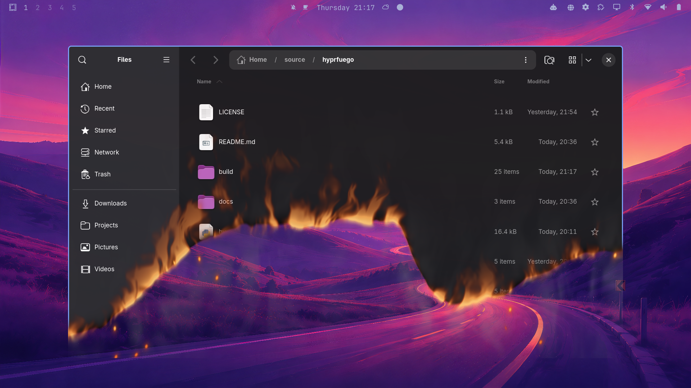

# Hyprfuego

A Compiz-inspired burn animation for closing Hyprland windows, with turbulent
flames, a charred edge, 48 drifting sparks and translucent smoke. Each close gets
a fresh bottom-up burn shape. The default duration is **1.15 seconds**.

Most shapes use five smooth control points, with occasional broader four-point
and more detailed six-point shapes. Point spacing varies independently, and the
selector avoids shapes similar to the last sixteen closes on the workspace.
The smooth joins and existing height limits are preserved.



[Animation](docs/images/burn-preview.gif) ·
[Animation snapshots](docs/images/burn-contact-sheet.png) ·
[Different close patterns](docs/images/burn-patterns.png)

The screenshot shows a live Files window closing. The linked animation and
snapshots are rendered from the actual shader on a synthetic window. This is a
shader recreation, not a port of Compiz's particle engine.

## Compatibility

Pinned to **Hyprland 0.56.2**, commit
`efb50993780079460b0cbed1363e2166a2de1d9f`, with Lua configuration. The loader
checks the running compositor, installed headers and plugin checksum. It refuses
to load against a different compositor revision; disable remains available after
an upgrade.

Build dependencies: matching Hyprland development headers and dependencies,
Python 3, a C++23 compiler, make, pkg-config and binutils. The preview command also
needs Kitty. Plugin source is vendored, so building needs no network access.

## Try it

Run from a terminal inside your Hyprland session:

```bash
git clone https://github.com/brontosaurusrex/hyprfuego.git ~/source/hyprfuego
cd ~/source/hyprfuego
./hyprfuego preview
```

Already cloned? Start with `cd ~/source/hyprfuego`.

The preview opens a floating terminal and closes it after five seconds, playing
the burn at your selected duration. It restores the ordinary rules afterward,
without editing your configuration files. If the effect was already enabled,
it stays enabled.

## Enable and disable

```bash
./hyprfuego enable
./hyprfuego status
./hyprfuego disable
```

Enable backs up `~/.config/hypr/hyprland.lua`, creates the managed
`~/.config/hypr/hyprfuego.lua`, and adds one marked `dofile` block to the main
configuration. It loads the plugin now and at future session starts, then checks
for configuration errors. A failed apply restores the previous files.

Disable removes the marked block and unloads this installation's plugin.
Personal edits, source files, settings and backups are retained. Keep the source
directory in place while enabled: configuration and startup loading refer to it.

After updating native plugin source:

```bash
./hyprfuego reload
```

Reload builds first and verifies ownership before replacing the loaded binary.
If loading fails, it attempts to restore the previous build. Shader edits reload
automatically and do not require rebuilding the plugin.

## Duration

```bash
./hyprfuego duration          # show the current duration
./hyprfuego duration 1.8      # slower: 1.8 seconds
./hyprfuego duration 0.8      # faster: 0.8 seconds
./hyprfuego duration default  # restore the shader default (1.15 seconds)
```

Supported values are **0.1–5 seconds**. Settings are saved in
`~/.config/hyprfuego/config.json`, or under `$XDG_CONFIG_HOME` when set.
Changes apply to future closes of existing and newly opened windows; a burn
already underway keeps its original duration. Settings persist across logins and
enable/disable cycles. Playback keeps the original linear progress curve.

## Theme colors

```bash
./hyprfuego theme-colors on      # use the active Omarchy theme's accent
./hyprfuego theme-colors off     # restore natural fire colors (default)
./hyprfuego theme-colors toggle
./hyprfuego theme-colors         # show the setting
```

Flames and sparks follow your theme's accent, with brightness adjusted for dark
accents and pale hot cores. Theme switches apply on the next close; an animation
already running keeps its colors. Missing or invalid palettes fall back to natural
fire. The setting persists in `~/.config/hyprfuego/theme-colors` (or under
`$XDG_CONFIG_HOME`). Palettes come from
`~/.local/state/omarchy/current/theme/colors.toml` (or under `$XDG_STATE_HOME`).
The plugin reads these files once per close, with no disk reads per frame.

After updating from a version without theme colors, run `./hyprfuego reload` once.
[Color examples](docs/images/burn-theme-colors.png)

## Window behavior

Ordinary main windows burn, including independent windows from the same app.
Child/transient windows, modal dialogs and X11 override-redirect windows keep
their normal close behavior. Apps must report their window relationships
correctly; auxiliary windows advertised as independent main windows cannot be
identified reliably from process ID alone. Normal GTK main windows, including
Files, remain eligible.

Open animations keep your settings. Window reflow caused by a burn close is
retimed to finish with the burn; unrelated movement keeps its existing timing.
Fullscreen windows retain HyprWindowShade's default fullscreen policy.

The effect stays within the snapshot's original alpha, so flames and smoke do
not spill onto unrelated desktop areas. It uses three-octave turbulence and 48
procedural sparks. Inactive sparks are rejected before calculating their
geometry, and pixels outside visible effect envelopes skip expensive shading.

The flame palette concentrates pale highlights at the hot base, with softer amber
bodies and faint tips. Broad upward flow has more weight than fine turbulence;
faster-burning patches produce taller tongues, while slower patches stay low.
The local burn schedule also controls flame height, without extra noise samples.
Smoke is a restrained warm grey. Sparks vary in brightness, size and lifetime,
with smaller halos. A horizontal spark bound skips burn-profile evaluation for
pixels outside the spark's possible footprint. These refinements use the same
three noise octaves and 48 spark slots. Both shader size variants include them.

## Validation and previews

```bash
./hyprfuego check
python3 -m unittest discover -s tools -p 'test_*.py'
```

Shader checks need glslangValidator and Python with PyOpenGL, NumPy and Pillow.
They verify exact endpoints, transparency boundaries, premultiplied alpha,
decreasing opaque window area, visible smoke and sparks. Control tests cover
configuration rollback, plugin ownership, duration changes and preview cleanup.

To refresh the README's GIF and PNG snapshots from the current shader:

```bash
python3 tools/update_previews.py            # Mesa software rendering
python3 tools/update_previews.py --hardware # available GPU
```

This also validates 128 native-generated close seeds and CPU/GPU profile
agreement. Generated asset hashes and source hashes are recorded in
[the preview manifest](docs/images/manifest.json).

See [development and benchmarks](docs/development.md) for native tests,
performance measurements and the constant-size flame experiment.

## Credits and license

Hyprfuego includes the MIT-licensed
[HyprWindowShade](https://github.com/ManofJELLO/HyprWindowShade) source with local
integration fixes. See [upstream revision and patches](vendor/UPSTREAM.md),
[the project license](LICENSE) and [the upstream license](vendor/HyprWindowShade/LICENSE).
