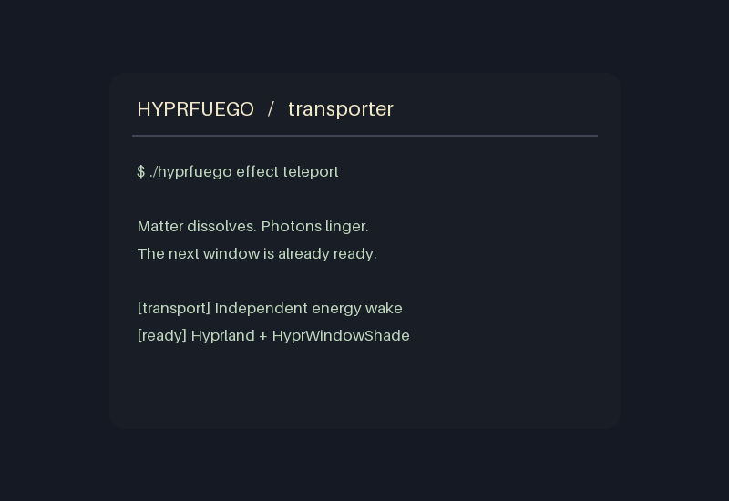

# Hyprfuego

Window-close effects for Hyprland: a Compiz-inspired burn and an experimental
transporter dissolve. Burn is the default, with turbulent flames, a charred edge, 48 drifting
sparks and translucent smoke, with a fresh bottom-up shape for every close.


[Animation](docs/images/burn-preview.gif) ·
[Animation snapshots](docs/images/burn-contact-sheet.png) ·
[Different close patterns](docs/images/burn-patterns.png)

The screenshot shows a live Files window closing. The linked animation and
snapshots are rendered from the actual shader on a synthetic window. This is a
shader recreation, not a port of Compiz's particle engine.

## Choose an effect

```bash
./hyprfuego effect           # current effect and available choices
./hyprfuego effect teleport  # try the experimental transporter
./hyprfuego effect burn      # return to fire
```

Effect selection applies to existing and newly opened main windows, and persists
across logins. Your duration preference is preserved when switching effects.

Teleport breaks up the window in random patches as narrow bluish-white shafts
arrive, resolve into a bright cloud of softly glowing, independently shimmering
particles, and scatter away. A gentle irregular drift and luminous haze connect
the particles. The window content is completely gone by
**38% of the duration**; transparent energy continues until the end. The closed
window immediately stops receiving input. The next window can receive focus and
keyboard input while the animation is still playing, and the layout keeps its
normal movement speed. Burn keeps its existing synchronized layout movement.



[Teleport snapshots](docs/images/teleport-contact-sheet.png)

Defaults are **1.15 seconds** for burn and **1.6 seconds** for teleport, unless
you have saved a duration. The preview above is rendered from the real shader.

## Compatibility

Pinned to **Hyprland 0.56.2**, commit
`efb50993780079460b0cbed1363e2166a2de1d9f`, with Lua configuration. The loader
checks the running compositor, installed headers and plugin checksum. It refuses
to load against a different compositor revision; disable remains available after
an upgrade.

Build dependencies: matching Hyprland development headers and dependencies,
Python 3, a C++23 compiler, make, pkg-config and binutils. The preview command also
needs Kitty. Plugin source is vendored, so building needs no network access.

## Try it

Run from a terminal inside your Hyprland session:

```bash
git clone https://github.com/brontosaurusrex/hyprfuego.git ~/source/hyprfuego
cd ~/source/hyprfuego
./hyprfuego preview
```

Already cloned? Start with `cd ~/source/hyprfuego`.

The preview opens a floating terminal and closes it after five seconds, playing
the selected effect at your configured duration. It restores the ordinary rules
afterward, without editing your configuration files. If the effect was already
enabled, it stays enabled.

## Enable and disable

```bash
./hyprfuego enable
./hyprfuego status
./hyprfuego disable
```

Enable backs up `~/.config/hypr/hyprland.lua`, creates the managed
`~/.config/hypr/hyprfuego.lua`, and adds one marked `dofile` block to the main
configuration. It loads the plugin now and at future session starts, then checks
for configuration errors. A failed apply restores the previous files.

Disable removes the marked block and unloads this installation's plugin.
Personal edits, source files, settings and backups are retained. Keep the source
directory in place while enabled: configuration and startup loading refer to it.

After updating native plugin source:

```bash
./hyprfuego reload
```

Reload builds first and verifies ownership before replacing the loaded binary.
If loading fails, it attempts to restore the previous build. Shader edits reload
automatically and do not require rebuilding the plugin.

## Duration

```bash
./hyprfuego duration          # show the current duration
./hyprfuego duration 1.8      # slower: 1.8 seconds
./hyprfuego duration 0.8      # faster: 0.8 seconds
./hyprfuego duration 20       # very slow: 20 seconds
./hyprfuego duration default  # restore the selected effect's default
```

Supported values are **0.1–20 seconds**, including fractional values. Settings
are saved in `~/.config/hyprfuego/config.json`, or under `$XDG_CONFIG_HOME` when set.
Changes apply to future closes of existing and newly opened windows; an animation
already underway keeps its original duration. Settings persist across logins and
enable/disable cycles. Duration includes the complete effect and its fading tail.

## Window behavior

Ordinary main windows receive the selected effect, including independent windows
from the same app. Child/transient windows, modal dialogs and X11 override-redirect windows keep
their normal close behavior. Apps must report their window relationships
correctly; auxiliary windows advertised as independent main windows cannot be
identified reliably from process ID alone. Normal GTK main windows, including
Files, remain eligible.

Open animations keep your settings. Window reflow caused by a burn close is
retimed to finish with the burn; unrelated movement keeps its existing timing.
Fullscreen windows retain HyprWindowShade's default fullscreen policy.

Both effects stay within the snapshot's original alpha. Burn uses three-octave
turbulence and 48 procedural sparks. Inactive sparks are rejected before calculating their
geometry, and pixels outside visible effect envelopes skip expensive shading.

The flame palette concentrates pale highlights at the hot base, with softer amber
bodies and faint tips. Broad upward flow has more weight than fine turbulence;
faster-burning patches produce taller tongues, while slower patches stay low.
The local burn schedule also controls flame height, without extra noise samples.
Smoke is a restrained warm grey. Sparks vary in brightness, size and lifetime,
with smaller halos. A horizontal spark bound skips burn-profile evaluation for
pixels outside the spark's possible footprint. These refinements use the same
three noise octaves and 48 spark slots. Both shader size variants include them.

## Validation and previews

```bash
./hyprfuego check
python3 -m unittest discover -s tools -p 'test_*.py'
```

Shader checks need glslangValidator and Python with PyOpenGL, NumPy and Pillow.
`check` validates the selected effect's exact endpoints, transparency boundaries,
premultiplied alpha and decreasing opaque window area. Burn also checks smoke,
sparks and close-shape variety. Teleport checks random breakup, a bluish-white
palette and an energy-only tail after the window content disappears. Control
tests cover configuration rollback, plugin ownership, effect switching, duration
changes and preview cleanup.

To refresh the README's GIF and PNG snapshots:

```bash
python3 tools/update_previews.py                    # burn, software rendering
python3 tools/update_previews.py --effect teleport  # teleport, software rendering
# Add --hardware to either command to use the available GPU.
```

Burn preview generation also validates 128 native-generated close seeds and
CPU/GPU profile agreement. Teleport checks 18 seeded energy wakes. Source and
asset hashes are recorded in the [burn manifest](docs/images/manifest.json) and
[teleport manifest](docs/images/teleport-manifest.json).

See [development and benchmarks](docs/development.md) for native tests,
performance measurements and the constant-size flame experiment.

## Credits and license

Hyprfuego includes the MIT-licensed
[HyprWindowShade](https://github.com/ManofJELLO/HyprWindowShade) source with local
integration fixes. See [upstream revision and patches](vendor/UPSTREAM.md),
[the project license](LICENSE) and [the upstream license](vendor/HyprWindowShade/LICENSE).
